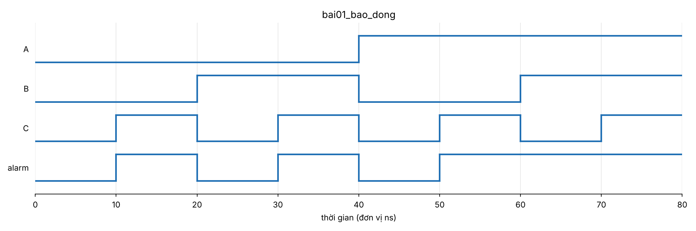

# Bài 1 — Mạch báo động bằng cổng logic

**Công cụ:** Icarus Verilog 12 (mô phỏng hành vi) + Surfer / `tools/ve_song.py` (waveform).
Vivado không cài được trên MacBook M2. Code RTL và testbench giữ nguyên, mở bằng Vivado vẫn chạy.

## 1. Đề bài và tín hiệu

Ba cảm biến A, B, C. `alarm` bật khi **A và B cùng bật**, hoặc **C bật**.

| Tín hiệu | Hướng | Độ rộng | Ý nghĩa |
|---|---|---|---|
| A, B, C | vào | 1 bit | trạng thái 3 cảm biến |
| alarm | ra | 1 bit | 1 = báo động |

## 2. Bảng chân trị

| A | B | C | A·B | alarm = A·B + C |
|---|---|---|---|---|
| 0 | 0 | 0 | 0 | **0** |
| 0 | 0 | 1 | 0 | **1** |
| 0 | 1 | 0 | 0 | **0** |
| 0 | 1 | 1 | 0 | **1** |
| 1 | 0 | 0 | 0 | **0** |
| 1 | 0 | 1 | 0 | **1** |
| 1 | 1 | 0 | 1 | **1** |
| 1 | 1 | 1 | 1 | **1** |

`alarm = 1` ở 5/8 tổ hợp: mọi dòng có C = 1 (4 dòng), cộng thêm dòng A = B = 1, C = 0.

Biểu thức `alarm = A·B + C` đã tối giản (bìa Karnaugh không gộp thêm được): 1 cổng AND 2 vào + 1 cổng OR 2 vào.

## 3. RTL — `bao_dong.v`

```verilog
module bao_dong (
    input  wire A,
    input  wire B,
    input  wire C,
    output wire alarm
);
    assign alarm = (A & B) | C;
endmodule
```

- Mạch tổ hợp nên dùng `assign` (gán liên tục): `alarm` luôn bằng biểu thức bên phải, không cần clock.
- `&`, `|` là phép AND, OR **theo bit**. Với tín hiệu 1 bit, kết quả giống `&&`, `||`, nhưng thói quen đúng
  khi mô tả cổng logic là dùng toán tử theo bit.
- `` `default_nettype none `` ở đầu file: gõ nhầm tên tín hiệu (ví dụ `alram`) thì trình biên dịch báo lỗi,
  thay vì âm thầm tạo một dây mới không nối vào đâu.

## 4. Testbench — `tb_bao_dong.v`

- Khai báo `reg A, B, C` (testbench tự gán) và `wire alarm` (do mạch điều khiển), nối DUT **theo tên cổng**.
- Vòng `for` đưa `{A, B, C} = 0 … 7`, đủ 8 tổ hợp, mỗi tổ hợp giữ 10 ns.
- Testbench **tự kiểm tra**: so `alarm` với bảng chân trị viết tay `MONG_DOI = 8'b1110_1010`
  (bit thứ i là alarm khi {A,B,C} = i), in PASS/FAIL từng dòng và tổng kết.
- Bảng mong đợi lấy từ **đề bài**, không chép lại biểu thức `(A & B) | C` của mạch. Kiểm mạch bằng chính
  công thức của nó thì sai ở đâu cũng ra PASS.
- So bằng `===` / `!==` để `alarm = x` (chưa nối dây, chưa có giá trị) cũng bị tính là sai.

## 5. Kết quả

```
 A B C | alarm | mong đợi | kết quả
 0 0 0 |   0   |    0     | PASS
 0 0 1 |   1   |    1     | PASS
 0 1 0 |   0   |    0     | PASS
 0 1 1 |   1   |    1     | PASS
 1 0 0 |   0   |    0     | PASS
 1 0 1 |   1   |    1     | PASS
 1 1 0 |   1   |    1     | PASS
 1 1 1 |   1   |    1     | PASS
KẾT QUẢ: PASS 8/8 tổ hợp
```



**Đọc waveform:** mỗi đoạn 10 ns là một tổ hợp, A là bit cao nên đổi chậm nhất (40 ns một lần), C là bit thấp
nên đổi nhanh nhất (10 ns).
- 10–20, 30–40, 50–60, 70–80 ns: C = 1 → alarm = 1 dù A, B bằng bao nhiêu.
- 60–70 ns: A = B = 1, C = 0 → alarm = 1. Đây là dòng duy nhất alarm bật nhờ nhánh A·B.
- 40–50 ns: A = 1 nhưng B = 0, C = 0 → alarm = 0. Chỉ một trong hai cảm biến A, B bật là chưa đủ.
- alarm đổi **cùng lúc** với đầu vào, không chờ cạnh clock nào: đúng tính chất mạch tổ hợp.

## 6. Bài học rút ra

1. **Quy trình:** đề bài → bảng chân trị → biểu thức → RTL → testbench → so waveform. Bảng chân trị làm
   **trước** RTL, và chính nó là "đáp án" để testbench so.
2. **Mạch tổ hợp mô tả bằng `assign`:** đầu ra là hàm của đầu vào hiện tại, không có clock, không nhớ.
3. **RTL và testbench khác nhau về bản chất:** RTL thành phần cứng thật; testbench chỉ chạy trong máy tính
   nên được dùng `#10`, `$display`, `for`, `$finish`.
4. **Testbench tự kiểm tra tốt hơn nhìn sóng bằng mắt:** 8 tổ hợp còn nhìn được, nhưng mạch lớn (như CNN
   sau này, 6.272 giá trị một lớp) chỉ có cách so tự động. Đây chính là cách golden model C int8 được dùng
   cho RTL của project.
5. **Mô phỏng không cần Vivado:** behavioral simulation chỉ cần trình mô phỏng Verilog. Icarus khác Vivado ở
   chỗ phải tự ghi waveform bằng `$dumpfile` / `$dumpvars`.

## 7. Câu hỏi tự kiểm (chuẩn bị khi Thầy hỏi)

1. Vì sao testbench khai báo A, B, C là `reg` còn alarm là `wire`?
2. Nếu viết `alarm = A & B | C` (không ngoặc) thì có đúng không? Vì sao?
3. Bỏ dòng `#10;` trong vòng lặp thì chuyện gì xảy ra?
4. Bảng mong đợi `8'b1110_1010`: bit nào ứng với A = 1, B = 0, C = 1?

## Chạy lại

```bash
cd ~/mnist-digit-project/rtl/bai-tap-nhap-mon
./chay.sh bai01_bao_dong        # biên dịch + mô phỏng + vẽ song.png
surfer bai01_bao_dong/song.vcd  # xem waveform tương tác
```
